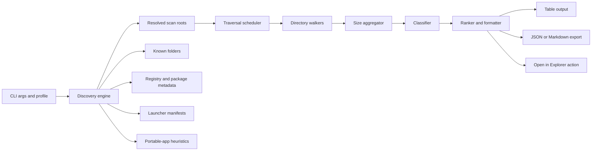
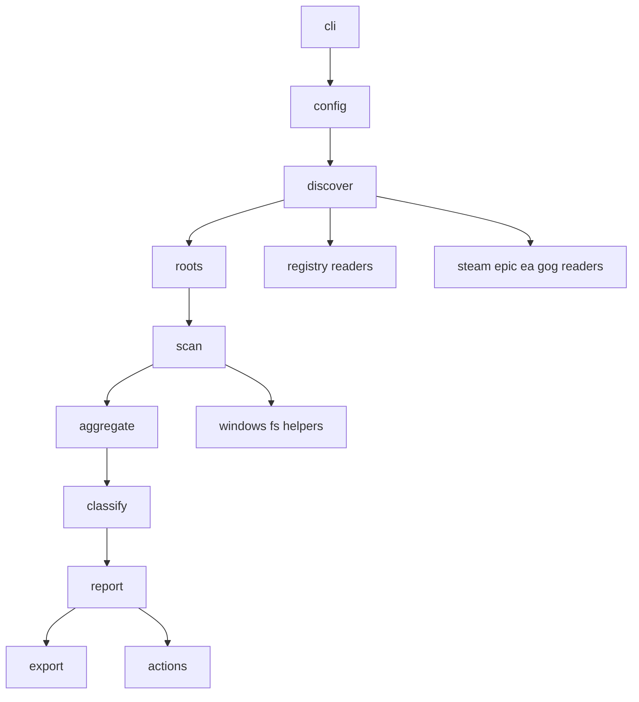
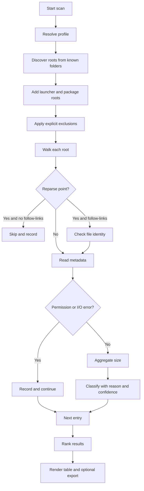

# Modern Windows Space Hunter CLI

## Executive summary

A well-designed “space hunter” for Windows should **not** behave like a generic disk-usage crawler. It should focus on **user-owned, actionable storage**: game installs, launcher libraries, mods, caches, saves, media, downloads, and portable app directories that a user can actually recognize and reclaim. The strongest product strategy is therefore a **targeted scan of curated roots**, enriched by **launcher/package metadata discovery**, followed by **classification and ranking**. That approach is more trustworthy, faster, and less noisy than recursively scanning the whole system drive. Windows exposes stable APIs for known folders, package enumeration, reparse-point detection, long-path support, package install locations, and directory/file change tracking; launcher ecosystems such as Steam, Epic, EA, and GOG expose enough metadata through manifests, settings, or registry state to make targeted discovery practical. citeturn24view7turn26view0turn26view1turn26view2turn26view3turn29view0turn31view0turn25view2turn25view5turn28view2turn27search14

For implementation, **Rust is the best primary choice for v1**. It gives you single-binary distribution, strong memory safety, very good filesystem performance, easy parallelism with Rayon, solid Windows API access through `windows`/`windows-registry`, and mature CLI/UI crates such as `clap`, `indicatif`, and `comfy-table`. Python is excellent for **rapid prototype validation**—especially if you use `os.scandir()`—but it is weaker for polished single-exe distribution and tends to leave more room for packaging friction and startup overhead. C# is a legitimate runner-up, especially if your team is already strong in .NET and wants easy registry/package access plus single-file publishing or Native AOT. C++ can be the absolute ceiling for control, but it comes with the highest implementation and maintenance cost for a QoL-focused CLI. citeturn6search1turn6search14turn13search0turn13search1turn13search2turn15search0turn15search2turn20search1turn22search0turn22search17turn23search0turn23search1turn21search6turn21search2

The recommended v1 architecture is a **two-phase scanner**. Phase one discovers scan roots from Windows known folders, user profile paths, registry/package metadata, and launcher manifests. Phase two walks only those roots, aggregates directory sizes safely, labels them with a confidence-bearing classifier, and outputs a friendly ranked report. By default, the tool should **not delete anything**, should **not follow reparse points**, should **record permission failures without aborting**, and should provide **JSON/Markdown exports** plus convenience actions like “open in Explorer.” Incremental rescans can later be accelerated with `ReadDirectoryChangesExW` or, for power users, an optional NTFS USN-journal mode. citeturn24view3turn37view2turn37view3turn24view6turn37view0turn33view1turn10search2turn39search0

Because the exact user environment is unspecified, the safest recommendation is to explicitly support and test **Windows 10 version 1607 or later** and **Windows 11**. Long-path behavior depends on both OS support and app opt-in, so the scanner should be built and manifested as `longPathAware`, and it should use Windows APIs or crates that tolerate extended-length paths correctly. citeturn38view0turn34view2

## Product scope, threat model, and safety defaults

The product scope should be narrow and opinionated: **find big, user-relevant directories that users may have forgotten about**. That means known folders such as `Downloads`, `Documents`, `Desktop`, `Saved Games`, user `AppData` variants, and launcher/package roots discovered from metadata—not system directories in general. Windows exposes these user locations through the Known Folders API, and `SHGetKnownFolderPath` is the correct foundation because it honors folder redirection and per-user layout rather than assuming hard-coded paths. citeturn24view7turn26view0turn26view1turn26view2turn26view3turn34view1

The safety model should assume four major classes of failure. The first is **destructive misuse**: users may interpret a storage report as safe-to-delete. The tool should therefore be **read-only by default**, with no deletion subcommand at all in v1. If deletion is ever introduced later, it should be opt-in, interactive, off by default, and never enabled for launcher manifests, package roots, or anything labeled low-confidence. This is a product policy recommendation rather than a platform requirement, but it matches the reality that launcher/package state is often coupled to manifests, registry entries, or app-specific storage semantics. Epic explicitly warns that deleting its manifest-bearing folder can make the launcher lose track of installs. citeturn29view0

The second failure class is **looping or double-counting through links**. On Windows, symbolic links and junctions are reparse points; mount points can be distinguished by `IO_REPARSE_TAG_MOUNT_POINT`, and symlinks by `IO_REPARSE_TAG_SYMLINK`. By default, the scanner should not follow links. If a power user enables `--follow-links`, the implementation should track visited `(volume serial, file ID)` pairs so the same directory tree is not counted multiple times. Windows documents that a file’s volume serial number plus file identifier uniquely identify a file on a single computer. citeturn10search2turn7search2turn7search17turn39search0turn39search5

The third class is **permission and path failures**. A practical Windows scanner must continue on `AccessDenied`, long paths, broken links, and transient I/O problems, then summarize those failures at the end. The `walkdir` crate’s docs explicitly support efficient skipping and note that permission-denied entries can be ignored rather than aborting traversal; Windows also documents the long-path model and the need for app opt-in. citeturn33view0turn33view1turn38view0

The fourth class is **privacy over-collection**. A storage tool will inevitably touch personal folders and cached application data. The right design is not “scan everything and hide it later,” but **limit traversal up front** to approved roots and label results conservatively. Store/packaged app data is especially sensitive: Windows app-local storage includes `LocalState`, `LocalCache`, and `Temporary`-style data, with different persistence characteristics. Your scanner should report large package-owned data stores, but it should not inspect file contents and should avoid over-describing personal data. citeturn27search14turn27search1turn27search3

A good default safety profile is:

| Default           | Recommendation         | Why                                                                                                              |
|-------------------|------------------------|------------------------------------------------------------------------------------------------------------------|
| Mutations         | None                   | Read-only by default prevents accidental damage; launcher metadata can be fragile. citeturn29view0            |
| Links             | Do not follow          | Reparse points can create loops, double-counting, or scan escape. citeturn10search2turn33view1turn39search0 |
| Permission errors | Record and continue    | Windows/user environments often contain inaccessible subtrees. citeturn33view0turn37view3                    |
| Long paths        | Support if possible    | Windows supports long paths with opt-in and `\\?\` semantics. citeturn38view0turn34view2                     |
| Classification    | Confidence-based       | Mislabeling is worse than “Unknown”; use explicit confidence levels.                                             |
| Output            | Explain “why detected” | Users trust reports more when the source is visible.                                                             |

## Targeted scan roots, discovery strategy, exclusions, and classification

The scanner should discover roots in **priority order**, so the most trustworthy and action-relevant sources dominate. Start with Windows known folders and the user profile, then layer launcher/package metadata, then fall back to portable-app heuristics. Known Folders should include at least `Downloads`, `Documents`, `Desktop`, `Pictures`, `Videos`, `Music`, `Saved Games`, `LocalAppData`, and `RoamingAppData`; those are documented by `KNOWNFOLDERID`, and `Saved Games` is especially important for games that leave large save/mod directories outside launcher roots. citeturn24view7turn26view0turn26view1turn26view2turn26view3

For **Steam**, the strongest official artifacts are the per-app manifests under `steamapps\appmanifest_[appid].acf`, which Valve documents as showing current install state. Valve’s public documentation does not robustly specify the `libraryfolders.vdf` schema, so you should treat it as **de facto metadata** and parse it tolerantly rather than rigidly. In practice, Steam detection should use this order: detect the Steam root, parse `libraryfolders.vdf` if present, enumerate each library’s `steamapps`, and then use `appmanifest_*.acf` and `steamapps\common` to label installed titles. The important architectural point is that `libraryfolders.vdf` is a discovery hint, while `appmanifest_*.acf` is the per-title authority. citeturn31view0turn35search1turn35search2

For **Epic Games Launcher**, Epic explicitly documents that launcher manifests storing game/application install location information live in `%ProgramData%\Epic` and that registry `InstallLocation` overrides may exist under several `EpicGamesLauncher\Overrides` registry hives. That gives you a strong detection order: `%ProgramData%\Epic` manifests first, Epic override registry keys second, then known launcher install roots only as fallback. citeturn29view0

For **EA App**, EA’s own support states that the EA app itself is installed by default at `C:\Program Files\Electronic Arts\EA Desktop\EA Desktop`, and another EA support article references game content under `C:\Program Files\EA Games`. That is enough to justify a detection order of: uninstall/launcher registry keys, default EA app root, then adjacent `EA Games` library roots and user cache roots. citeturn24view1turn25view5

For **GOG Galaxy**, GOG support documents that the Galaxy settings panel exposes the configured default **games installation folder**, temporary update folder, and other download folder, and GOG support articles also show offline-installer defaults under `C:\GOG Games\...`. Detection should therefore prefer Galaxy settings/config data if present, then fall back to the common `C:\GOG Games` convention and uninstall metadata. citeturn24view2turn25view6

For **Windows Store / Xbox / packaged apps**, do not start by crawling `WindowsApps`. Enumerate packages through `PackageManager.FindPackages*` or `Get-AppxPackage`, which Windows documents for package discovery and which expose package identity plus install location. For user-owned storage relevant to reclaiming space, prioritize package data under the local app-data store—especially `LocalState`, `LocalCache`, and other path-backed app data—because that is where user-visible cache and app-local data accumulation tends to live. This is also more consistent with the product goal than crawling protected package install directories. citeturn28view2turn25view4turn27search14turn27search1turn27search12

For **Ubisoft Connect, Battle.net, and other launchers without stable public manifest docs**, the best v1 approach is pragmatic: use Windows uninstall registry keys and launcher install locations as the primary metadata source, then scan likely sibling library/config/cache roots under user-owned directories and launcher-specific install folders. Windows MSI/uninstall registry keys are the canonical generic source for installed applications, and both 32-bit and 64-bit registry views matter on 64-bit Windows. citeturn4search0turn15search0turn15search3turn21search7

A good scan-root matrix looks like this:

| Root type           | How to discover                                                                                                          |                                    Confidence | Why it matters                                                                     |
|---------------------|--------------------------------------------------------------------------------------------------------------------------|----------------------------------------------:|------------------------------------------------------------------------------------|
| Known user folders  | `SHGetKnownFolderPath` / Known Folders API citeturn24view7turn34view1                                                |                                          High | Captures personal files, portable apps, saves, media, downloads.                   |
| Steam libraries     | Steam root → `libraryfolders.vdf` → `appmanifest_*.acf` citeturn31view0turn35search1turn35search2                   |                                          High | Best source for hidden Steam installs.                                             |
| Epic installs       | `%ProgramData%\Epic` manifests; Epic override registry keys citeturn29view0                                           |                                          High | Officially documented manifest/override model.                                     |
| EA installs         | EA app root, uninstall metadata, `EA Games` roots citeturn24view1turn25view5                                         |                                   Medium-High | Good for launcher + game roots.                                                    |
| GOG installs        | Galaxy settings, download/install folder config, `C:\GOG Games` fallback citeturn24view2turn25view6                  |                                   Medium-High | Good for Galaxy and offline-installer installs.                                    |
| Store/Xbox packages | `PackageManager` / `Get-AppxPackage`; app data under package-local storage citeturn28view2turn25view4turn27search14 | High for packages, medium for space relevance | Strong package discovery; report app-local storage, not protected system payloads. |
| Portable apps       | Heuristics in `Downloads`, `Desktop`, `Documents`, custom folders citeturn26view0turn26view3                         |                                        Medium | Catches forgotten standalone tools and unpacked games.                             |

The exclusion policy should be explicit and opinionated. Recommended default exclusions are `C:\Windows`, `C:\Program Files`, `C:\Program Files (x86)`, protected package payload directories, OS-owned Microsoft subtrees under AppData, recycle/system-volume areas, and any path outside approved scan roots unless it is launcher-discovered. This is fundamentally a **product decision**: your goal is not “largest directories anywhere,” but “largest directories the user likely owns or can reason about.” For packaged apps, that means preferring package-local storage over protected install payloads; for launcher content, that means manifests and library roots over entire system volumes. citeturn28view2turn27search14turn24view7

Classification should be **rules-first, heuristic-second, confidence-tagged**. A practical v1 classifier can use this logic:

| Label        | Strong signals                                                                                           | Secondary signals                                                     | Confidence    |
|--------------|----------------------------------------------------------------------------------------------------------|-----------------------------------------------------------------------|---------------|
| Game         | Steam/Epic/EA/GOG/Store manifest or package metadata; installed executable under a launcher library root | Large content directory under known game-library path                 | High / Medium |
| Launcher     | Uninstall registry entry, vendor install root, known executable name                                     | Vendor cache/config plus update folders                               | High / Medium |
| Mods         | Child of detected game root with names like `mods`, `workshop`, `addons`, or mod-manager markers         | File-heavy subordinate directory that depends on a detected game root | Medium        |
| Cache        | `LocalCache`, temp/update/download staging roots, launcher cache patterns                                | Large volatile subtree in `LocalAppData`                              | High / Medium |
| Media        | Known folders `Videos`, `Pictures`, `Music`                                                              | Extensions and folder names                                           | High / Medium |
| Downloads    | `Downloads` known folder or launcher “other downloads” roots                                             | Archive/extractor patterns                                            | High / Medium |
| Portable app | Executable-containing directory in `Downloads`/`Desktop`/`Documents` not tied to installer metadata      | High local size plus app-like structure                               | Medium        |
| Unknown      | None                                                                                                     | Retain and report clearly                                             | Low           |

A helpful rule is to surface **why** a label was assigned, such as `reason=steam appmanifest`, `reason=epic manifest`, `reason=package LocalState`, or `reason=portable exe tree under Downloads`. That explanation does more for trust than adding another dozen fragile heuristics.

## Architecture, data flow, and performance engineering

The core architecture should separate **discovery**, **traversal**, **aggregation**, **classification**, and **presentation** so that each stage remains testable and replaceable. That also makes it easy to add an incremental mode later without rewriting the CLI or classifier.



The cleanest Rust implementation is a **hybrid parallel traversal**. Use a discovery step to build a bounded set of roots. Then traverse roots concurrently, but keep aggregation streaming and memory-light. For directory walking, three workable options exist. `walkdir` is reliable and explicit; it supports max-depth pruning, link defaults that are safe, and limits on simultaneous open descriptors. `ignore` adds a fast recursive iterator plus `WalkParallel`, but its default behavior is opinionated toward `.gitignore`/hidden-file semantics, which you probably want to disable or tightly control for a Windows storage tool. `jwalk` is attractive when you want directory-level parallelism with a streaming-like API. citeturn33view0turn33view1turn33view3turn24view8turn24view9

The best v1 recommendation is:

| Crate                  | Use it for                         | Why                                                                                                             | Alternative                                                          |
|------------------------|------------------------------------|-----------------------------------------------------------------------------------------------------------------|----------------------------------------------------------------------|
| `clap`                 | CLI parsing                        | Mature derive API, subcommands, enums, strong ergonomics. citeturn13search0turn13search4                    | `argh`, `bpaf`                                                       |
| `rayon`                | Parallel work scheduling           | Battle-tested work-stealing pool; `join`, `scope`, and custom pool builder. citeturn6search1turn6search17   | `crossbeam` + custom workers                                         |
| `walkdir`              | Safe recursive walking             | Good defaults, pruning, optional link following, descriptor limits. citeturn33view0turn33view1              | `ignore`, `jwalk`                                                    |
| `ignore`               | Parallel walking if you want it    | Fast recursive iterator and `WalkParallel`. citeturn33view3turn24view8                                      | `jwalk`                                                              |
| `jwalk`                | Parallel directory-level traversal | Designed to combine `ignore`-style parallelism with `walkdir`-style streaming. citeturn24view9turn14search8 | `ignore::WalkParallel`                                               |
| `windows`              | Win32/WinRT bindings               | Official Rust for Windows API surface. citeturn15search2turn13search19                                      | Raw FFI                                                              |
| `windows-registry`     | Registry access                    | Windows-specific, simple, safe registry API. citeturn34view0                                                 | `winreg` citeturn15search3                                        |
| `known-folders`        | Known folder lookup                | Thin wrapper over `SHGetKnownFolderPath`. citeturn34view1                                                    | Call Win32 directly                                                  |
| `keyvalues-serde`      | Steam VDF parsing                  | Strongly typed VDF parsing via Serde. citeturn35search1turn35search10                                       | `keyvalues-parser` for tolerant untyped parsing citeturn35search2 |
| `serde` + `serde_json` | Export                             | Standard structured serialization. citeturn35search16turn36search0                                          | Manual JSON                                                          |
| `indicatif`            | Progress UI                        | Thread-safe bars/spinners; good stderr behavior. citeturn13search1turn33view2                               | `prodash`, `headway`                                                 |
| `comfy-table`          | Pretty terminal tables             | Unicode/width-aware tables. citeturn13search2turn13search6                                                  | `tabled`                                                             |
| `dunce`                | Windows path normalization         | Converts UNC/extended paths to friendlier legacy forms when safe. citeturn34view2                            | Custom formatter                                                     |
| `same-file`            | Link/identity checks               | Safe file identity comparisons; useful for dedupe/loop prevention. citeturn34view3                           | Win32 `FILE_ID_INFO` directly                                        |

For concurrency, prefer **threaded traversal over async filesystem I/O**. Tokio’s own docs state that most operating systems do not provide asynchronous filesystem APIs in the way network APIs do, and Tokio’s `fs` operations use ordinary blocking file operations behind the scenes via `spawn_blocking`. For a disk-bound scanner, that usually means a plain Rayon or worker-thread model is the simpler and clearer choice. Async becomes more compelling only if the CLI also does significant networking or other latency-hiding work. citeturn20search1turn20search21

At the Windows API level, there are three tiers of sophistication. The baseline is ordinary directory enumeration with metadata queries. The next tier is **`ReadDirectoryChangesW` / `ReadDirectoryChangesExW`** for incremental refresh of already-known roots; Microsoft documents that `ReadDirectoryChangesExW` can return extended change information, while `ReadDirectoryChangesW` requires careful buffer handling and may force re-enumeration on overflow. The most advanced tier is the **NTFS USN Journal**, which is excellent for incremental indexing because it logs changes per volume, but it is explicitly NTFS-specific, requires volume handles like `\\.\X:`, and stores a change log—not a complete point-in-time inventory—so it does not replace the initial full scan. citeturn24view3turn37view3turn37view2turn24view6turn37view0turn37view1

A sensible performance stance is therefore:

| Method                    | Best use                            | Upside                                           | Cost / downside                                                                                    |
|---------------------------|-------------------------------------|--------------------------------------------------|----------------------------------------------------------------------------------------------------|
| Parallel full traversal   | Initial scan                        | Simple, robust, portable across Windows installs | Cold-scan I/O costs remain real                                                                    |
| `ReadDirectoryChangesExW` | Live refresh of watched roots       | Good delta updates with richer notifications     | Buffer management and watcher complexity citeturn24view3turn37view3                            |
| USN Journal               | Power-user incremental mode on NTFS | Very fast change tracking at volume scale        | NTFS-only, more complexity, not a full inventory source citeturn24view6turn37view0turn37view1 |

The internal module layout can be straightforward:



Recommended modules:

- `cli`: `clap` structs, profiles, flags, output mode.
- `config`: profile resolution, include/exclude sets, defaults.
- `discover`: known folders, registry, package enumeration, launcher manifests.
- `fswin`: path normalization, reparse detection, file identity helpers, long-path helpers.
- `scan`: traversal orchestration, worker scheduling, error collection.
- `aggregate`: subtree size accounting and top-N maintenance.
- `classify`: deterministic rules plus confidence/reason strings.
- `report`: terminal table, JSON, Markdown.
- `actions`: Explorer opening, file export, optional future cleanup flows.

Critical-path pseudocode should look like this:

```rust
// Parallel directory walker with safe defaults
fn scan_roots(roots: Vec<ScanRoot>, opts: ScanOptions) -> ScanResult {
    let pool = rayon::ThreadPoolBuilder::new()
        .num_threads(opts.threads)
        .build()
        .unwrap();

    pool.install(|| {
        roots.par_iter()
            .map(|root| scan_one_root(root, &opts))
            .reduce(ScanAcc::empty, |a, b| a.merge(b))
    })
}

fn scan_one_root(root: &ScanRoot, opts: &ScanOptions) -> ScanAcc {
    let mut acc = ScanAcc::for_root(root.clone());
    let walker = walkdir::WalkDir::new(&root.path)
        .follow_links(opts.follow_links)
        .max_depth(root.max_depth.unwrap_or(usize::MAX));

    for entry in walker.into_iter() {
        match entry {
            Ok(de) => {
                if should_prune(&de, opts) { continue; }
                if is_reparse_dir(&de) && !opts.follow_links {
                    acc.note_skipped_link(de.path());
                    continue;
                }
                if let Ok(meta) = de.metadata() {
                    if meta.is_file() {
                        acc.add_file(de.path(), meta.len());
                    } else if meta.is_dir() {
                        acc.note_dir(de.path());
                    }
                } else {
                    acc.record_error(de.path(), "metadata_failed");
                }
            }
            Err(err) => acc.record_walk_error(err),
        }
    }
    acc
}
```

```rust
// Steam library parser: tolerant, not brittle
fn discover_steam_libraries(steam_root: &Path) -> Vec<PathBuf> {
    let mut libs = vec![steam_root.to_path_buf()];

    let lf = steam_root.join("steamapps").join("libraryfolders.vdf");
    if let Ok(text) = std::fs::read_to_string(&lf) {
        if let Ok(vdf) = keyvalues_parser::parse(&text) {
            for path in extract_library_paths_tolerant(&vdf) {
                libs.push(path);
            }
        }
    }

    libs.sort();
    libs.dedup();
    libs
}
```

```rust
// Confidence-bearing classification
fn classify(node: &DirNode, ctx: &ClassifyCtx) -> Label {
    if ctx.steam_appmanifests.contains_key(&node.path) {
        return Label::game("steam appmanifest", Confidence::High);
    }
    if ctx.epic_manifests.contains_key(&node.path) {
        return Label::game("epic manifest", Confidence::High);
    }
    if ctx.package_local_state.contains(&node.path) {
        return Label::cache("package local state", Confidence::High);
    }
    if node.is_under(&ctx.known.downloads) && node.contains_portable_exe_tree() {
        return Label::portable_app("portable app heuristic", Confidence::Medium);
    }
    if node.path_ends_with_any(&["mods", "workshop", "addons"]) && node.has_detected_game_ancestor() {
        return Label::mods("game child heuristic", Confidence::Medium);
    }
    Label::unknown("no strong signal", Confidence::Low)
}
```

```rust
// Safe size aggregation: postorder roll-up
fn rollup_sizes(tree: &mut Tree) {
    for node_id in tree.postorder_ids() {
        let file_bytes = tree[node_id].direct_file_bytes;
        let child_bytes: u64 = tree[node_id]
            .children
            .iter()
            .map(|c| tree[*c].total_bytes)
            .sum();
        tree[node_id].total_bytes = file_bytes.saturating_add(child_bytes);
    }
}
```

## CLI experience, output design, packaging, and distribution

A modern QoL CLI wins on **trust and delight**, not just raw speed. That means the default command should feel obvious, the output should be readable in one screen, and the tool should make it easy to move from “what is large?” to “show me that folder.” `clap` provides strong command/subcommand ergonomics; `indicatif` provides progress bars that are thread-safe and default to stderr; `comfy-table` provides visually pleasing tables in UTF-8 terminals. citeturn13search0turn13search1turn13search2turn33view2

Recommended command surface:

```text
space-hunter scan
space-hunter scan --profile games
space-hunter scan --profile user --top 50 --json out.json
space-hunter scan --follow-links
space-hunter roots
space-hunter explain "C:\Users\you\AppData\Local\Packages\..."
space-hunter open 7
space-hunter export --markdown report.md
```

Recommended flags and patterns:

| UX feature                                                             | Why it matters                                              |
|------------------------------------------------------------------------|-------------------------------------------------------------|
| Profiles such as `games`, `user`, `launchers`, `media`, `all-targeted` | Lets the tool stay opinionated without becoming inflexible. |
| `--top`, `--min-size`, `--max-depth`                                   | Makes large-result sets manageable.                         |
| `--json`, `--markdown`, `--table`                                      | Supports both humans and automation.                        |
| `--open` / `open <row>`                                                | Converts insight into action fast.                          |
| `--follow-links` explicit toggle                                       | Keeps safe default behavior visible.                        |
| `--dry-run` semantics for future cleanup workflows                     | Prepares the UX even before delete/move operations exist.   |
| `--explain`                                                            | Shows source, classifier reason, confidence, and errors.    |
| `--no-progress`                                                        | Important for logs/CI.                                      |

An example table output:

```text
SPACE HUNTER  top 12 results  profile=all-targeted  roots=18  errors=7

Rank  Size      Label      Confidence  Source                Path
1     184.3 GB  Game       High        steam appmanifest     D:\SteamLibrary\steamapps\common\Baldurs Gate 3
2      73.8 GB  Cache      High        package LocalCache    C:\Users\you\AppData\Local\Packages\...\LocalCache
3      61.2 GB  Downloads  High        known folder          C:\Users\you\Downloads
4      49.0 GB  Game       High        epic manifest         E:\Epic Games\Fortnite
5      21.7 GB  Mods       Medium      game child heuristic  D:\SteamLibrary\steamapps\workshop\content\...
```

For JSON, keep the schema automation-friendly:

```json
{
  "scanned_at": "2026-06-20T12:34:56Z",
  "profile": "all-targeted",
  "roots": [
    {"path":"C:\\Users\\you\\Downloads","source":"known_folder"}
  ],
  "results": [
    {
      "rank": 1,
      "path": "D:\\SteamLibrary\\steamapps\\common\\Game",
      "bytes": 197892734976,
      "label": "Game",
      "confidence": "high",
      "reason": "steam appmanifest",
      "root_source": "steam_library",
      "errors": []
    }
  ],
  "summary": {
    "permission_errors": 7,
    "skipped_reparse_points": 12
  }
}
```

On packaging and distribution, Rust naturally produces a single Windows executable as a normal binary target. If you want to control C runtime linkage, the Rust reference documents `crt-static`, with the caveat that support depends on the target and you should verify the resulting binary. Code signing should use Authenticode tooling such as `SignTool`, and you should expect SmartScreen to evaluate file reputation for downloaded binaries. In other words: ship a clean binary, sign it, timestamp it, and avoid surprising runtime behavior that can trigger endpoint security suspicion. citeturn12search8turn12search5turn12search1turn5search13turn5search1turn24view5turn5search8

A language comparison for shipping looks like this:

| Language |                                                                                          Speed | Dev speed |                                              Windows integration |                                                                                        Single-exe story | Recommendation                          |
|----------|-----------------------------------------------------------------------------------------------:|----------:|-----------------------------------------------------------------:|--------------------------------------------------------------------------------------------------------:|-----------------------------------------|
| Rust     |                                                                                           High |    Medium | High via `windows` ecosystem citeturn15search2turn13search19 |                                                                        Strong conventional binary model | **Best primary choice**                 |
| Python   | Medium for targeted scans; much better with `os.scandir()` citeturn22search0turn22search17 | Very high |                                                           Medium | PyInstaller works, but one-file startup/distribution is less elegant citeturn22search2turn22search5 | Best for prototype                      |
| C#       |                                                                                    High enough |      High |                                                        Very high |                        Single-file publish and Native AOT are strong citeturn23search0turn23search1 | Strong second choice                    |
| C++      |                                                                                Highest control |    Lowest |                                                        Very high |                                                                                       Native by default | Use only if your team already wants C++ |

## Testing, benchmarks, privacy, and v1 roadmap

A convincing benchmark plan has to measure both **speed** and **correctness**. Speed alone is not enough because this product is fundamentally about trusted classification. Your benchmark datasets should therefore include: a Steam-heavy machine, an Epic/EA/GOG mixed machine, a Store-heavy machine with package data bloat, a portable-app hobbyist machine, and one synthetic stress corpus with millions of tiny files, deep long paths, reparse loops, junctions, symlinks, access-denied folders, and a large NTFS volume for incremental tests. Windows long-path and reparse-point behavior must be exercised explicitly on both Windows 10 and Windows 11 because long-path support is opt-in and path formatting rules differ between shell-safe and Win32-safe forms. citeturn38view0turn10search2turn39search0

Recommended metrics:

| Metric                             | Measures                                      |
|------------------------------------|-----------------------------------------------|
| Cold scan wall-clock time          | First-run speed                               |
| Warm scan wall-clock time          | Benefit of metadata cache / file-system cache |
| Files/sec and dirs/sec             | Traversal throughput                          |
| Bytes read vs bytes classified     | I/O efficiency                                |
| Peak RSS                           | Memory behavior                               |
| Permission error count             | Robustness                                    |
| Misclassification rate by label    | Result quality                                |
| False negatives for known installs | Discovery completeness                        |
| Time-to-first-result               | UX responsiveness                             |

Example benchmark commands:

```text
space-hunter scan --profile all-targeted --top 200 --json bench-cold.json
space-hunter scan --profile games --threads 16 --no-progress
space-hunter scan --profile all-targeted --max-depth 6
space-hunter scan --profile launchers --follow-links
```

Correctness testing should include fixture-based discovery tests for Steam/Epic/GOG/EA metadata parsing, contract tests for known folders and registry readers, and end-to-end golden-report tests. For Windows package discovery, add admin/non-admin scenarios, because package enumeration behavior differs depending on whether you query current-user packages or all-user package sets. Windows documents those permission distinctions for `Get-AppxPackage` and `PackageManager.FindPackages`. citeturn25view4turn28view2

Privacy and security considerations should be communicated clearly in the README and help text. The tool scans filenames, directory structure, sizes, and selected metadata sources; it should not transmit data anywhere; JSON export should be local only; and logs should avoid embedding large lists of personal paths unless the user requests verbose mode. If you later add telemetry, it must be opt-in. For packaged apps, explicitly distinguish **installed payload** from **user-local data** in your UI, because those have very different privacy and cleanup implications. citeturn28view2turn27search14

A pragmatic v1 milestone plan is:

| Milestone                     | Scope                                                     | Estimated effort |
|-------------------------------|-----------------------------------------------------------|-----------------:|
| Repo/bootstrap                | CLI skeleton, config, logging, CI, release profile        |        0.5–1 day |
| Known-folder discovery        | `SHGetKnownFolderPath` integration, baseline roots        |          0.5 day |
| Registry/package discovery    | uninstall keys, Appx/PackageManager integration           |         1–2 days |
| Steam/Epic/GOG/EA discoverers | VDF parser, manifest/config readers, fallback rules       |         2–4 days |
| Traversal engine              | walker, pruning, aggregation, error collection            |         2–3 days |
| Classification engine         | rules, confidence, explain output                         |         1–2 days |
| Table/JSON/Markdown reporters | polished terminal UX and exports                          |         1–2 days |
| Windows path/link hardening   | reparse handling, file IDs, long-path manifest            |         1–2 days |
| Test corpus + golden tests    | fixtures, performance harness, Windows CI smoke tests     |         2–4 days |
| Packaging + signing pipeline  | release build, signed binary, Defender/SmartScreen checks |         1–2 days |

A concrete v1 checklist:

- Build a Rust CLI with `clap`, `rayon`, `walkdir`, `windows`, `windows-registry`, `serde`, `serde_json`, `indicatif`, and `comfy-table`. citeturn13search0turn6search1turn33view0turn15search2turn34view0turn36search0turn13search1turn13search2
- Implement known-folder discovery first. citeturn24view7turn26view0turn26view1turn26view2turn26view3
- Add Steam, Epic, GOG, EA detection in that order. citeturn31view0turn29view0turn24view2turn25view5
- Add package discovery via current-user package enumeration and package-local data labeling. citeturn25view4turn28view2turn27search14
- Ship with read-only defaults, no link following, and explicit skipped/error summaries. citeturn33view1turn10search2
- Make the binary long-path aware and test on Windows 10/11. citeturn38view0
- Add signing in release automation and document SmartScreen expectations. citeturn5search13turn24view5

Finally, the scan decision logic should stay simple enough that users can predict it:



If the goal is a **beautifully designed, high-trust Windows CLI**, the winning v1 is not “the fastest possible filesystem crawler.” It is a **fast enough, safety-first, metadata-guided storage hunter** that produces a short list of large, recognizable things users can actually act on. Rust is the best fit for that balance.

---
